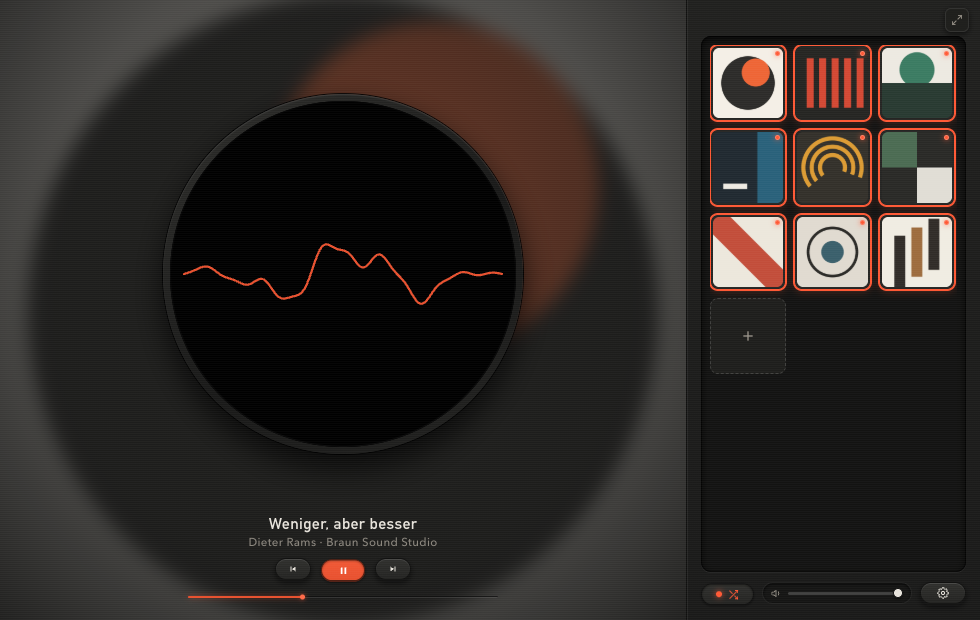
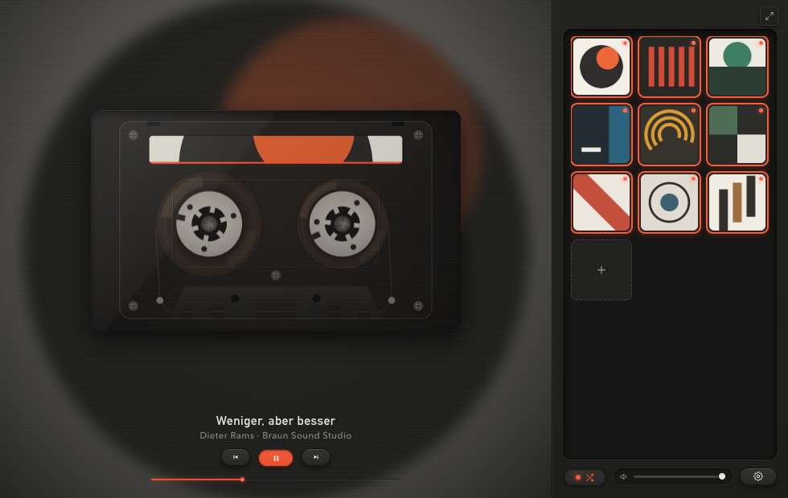
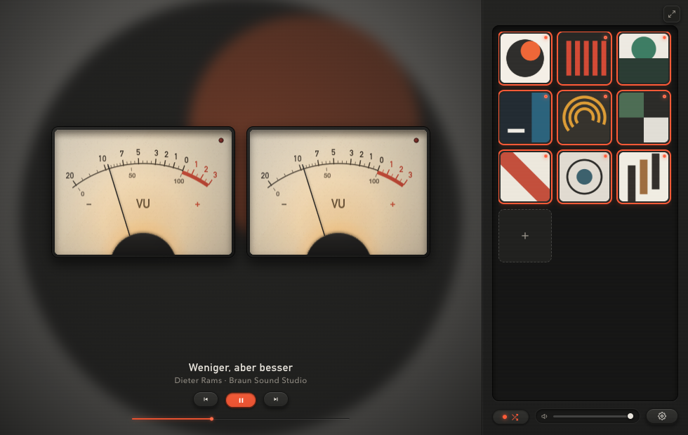
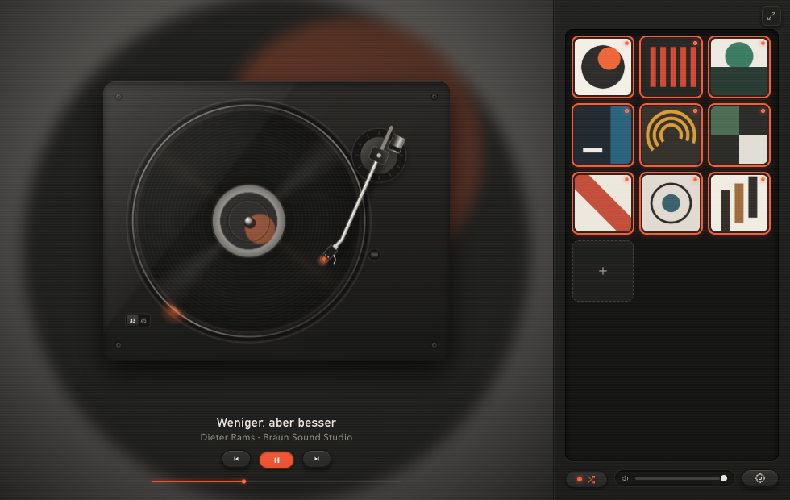
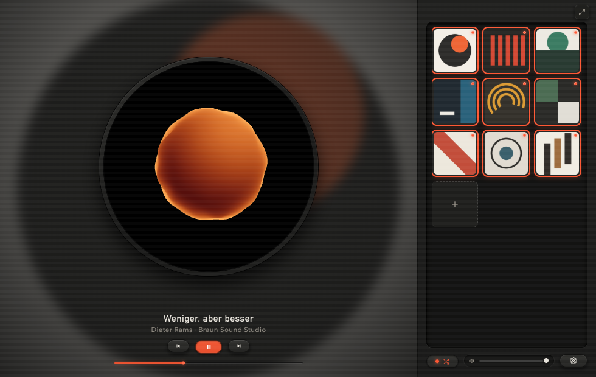
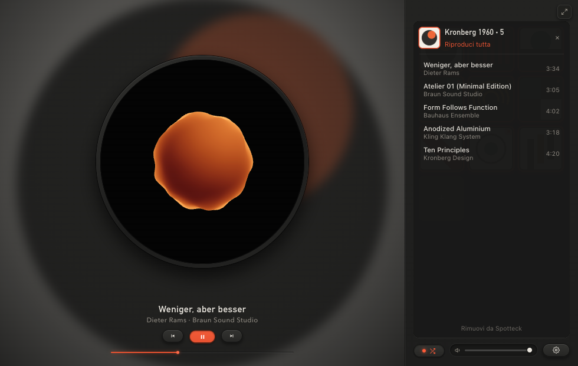

# Spotteck

> 🤖 **Per configurare tutto con un agente AI (Codex, Antigravity, ecc.):** dai questo file e il progetto 👉 [**SETUP_GUIDE.md**](SETUP_GUIDE.md)

Una nuova interfaccia per Spotify più bella, essenziale ed elegante.  
Elimina il disordine dell'app ufficiale e trasforma l'ascolto in un lettore compatto con visualizzatori analogici (oscilloscopio, cassetta, VU meter, vinile, fluido Aether).

**Requisiti:** un account **Spotify Premium** e macOS 14.2+ (Apple Silicon), Linux o Windows 10/11. Spotteck suona da solo: non serve l’app Spotify sul computer. Per compilarlo su ciascun sistema vedi [**SETUP_GUIDE.md**](SETUP_GUIDE.md#sviluppo).

---

### 📦 Download

| File | Piattaforma | Link |
| :--- | :--- | :--- |
| **Spotteck (DMG)** | macOS (Apple Silicon) | [**Download .dmg**](https://github.com/marcovernetto-lgtm/spotteck/releases/download/v1.0.0/Spotteck-1.0.0-arm64.dmg) |
| **Spotteck (ZIP)** | macOS (Apple Silicon) | [**Download .zip**](https://github.com/marcovernetto-lgtm/spotteck/releases/download/v1.0.0/Spotteck-1.0.0-arm64-mac.zip) |

📖 Guida completa: [**SETUP_GUIDE.md**](SETUP_GUIDE.md)

---

### 📸 Visualizzatori

| Oscilloscopio | Cassetta |
| :---: | :---: |
|  |  |

| VU Meter | Vinile |
| :---: | :---: |
|  |  |

| Fluido Aether | Lista Brani |
| :---: | :---: |
|  |  |

---

### 🕹️ Comandi

* **Clic Sinistro:** riproduce la playlist.
* **Clic Destro:** apre i brani della playlist.
* **Frecce (`←` / `→`):** brano precedente / successivo.
* **Spazio:** play / pausa.
* **Clic sul quadrante:** cambia visualizzatore.
* **Tasto `+`:** aggiunge una playlist da link Spotify.

---

*Disclaimer: Spotteck è un progetto open-source indipendente, non affiliato né approvato da Spotify AB.*
